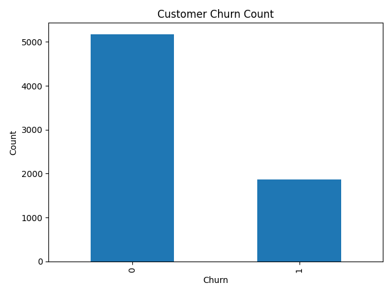
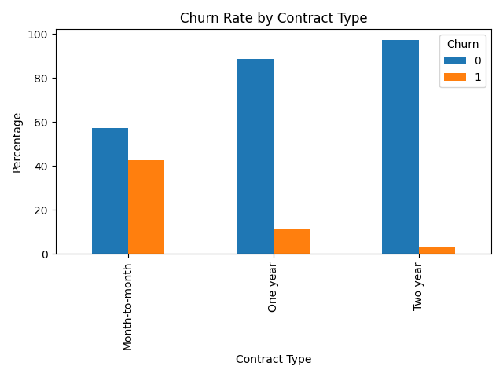
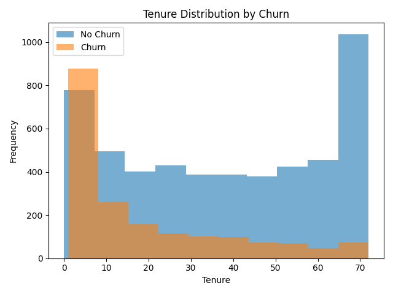
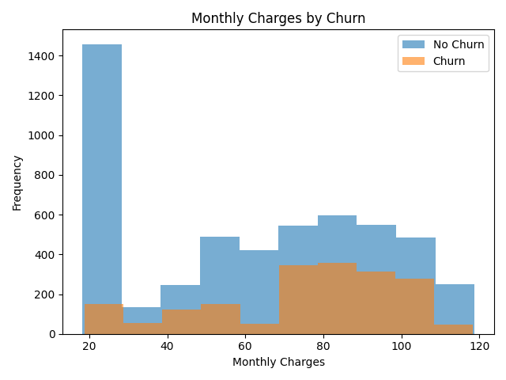
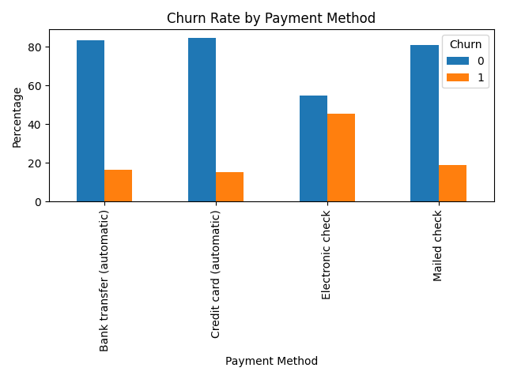
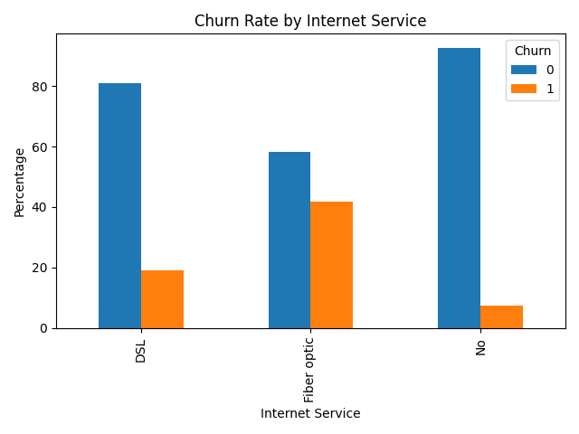
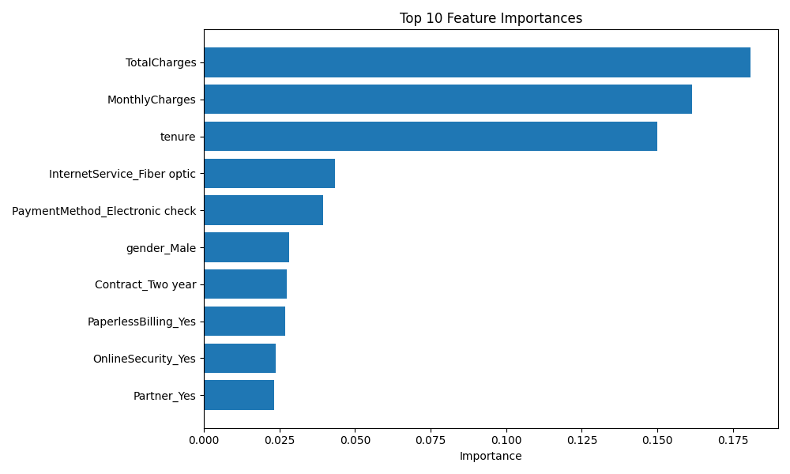

# Customer Churn Prediction and Retention Analysis

  

## Project Overview

This end-to-end data analytics project investigates customer churn in the telecommunications industry using exploratory data analysis, machine learning, and interactive Tableau dashboards. The goal is to identify customers at risk of leaving, understand factors associated with churn, and translate analytical findings into actionable retention strategies.

Completed as a Bachelor of Science in Data Analytics capstone at Western Governors University (WGU), April 2026.

## Business Problem

Customer churn threatens recurring revenue and long-term business growth. Understanding which customers are likely to leave and why can help telecommunications companies prioritize retention efforts, improve customer experience, and allocate resources more effectively.

**Research question:** Which customer characteristics, service attributes, and billing patterns are associated with churn, and how can predictive analytics support customer retention?

## Executive Summary

| Key performance indicator | Value |
| --- | ---: |
| Total customers | 7,043 |
| Churned customers | 1,869 |
| Retained customers | 5,174 |
| Churn rate | 26.54% |
| Retention rate | 73.46% |
| Average monthly charges | $64.76 |
| Average tenure | 32.37 months |

The analysis identifies month-to-month contracts, shorter customer tenure, electronic check payments, fiber optic service, and higher monthly charge ranges as important churn-related patterns. Logistic Regression achieved the strongest reported performance, with 80.13% accuracy and a 57.96% F1-score.

## Project Objectives

- Clean and prepare telecommunications customer data for analysis.
- Explore customer demographics, account information, and service usage.
- Identify customer segments with elevated churn rates.
- Develop and evaluate classification models for churn prediction.
- Build Tableau dashboards to communicate findings to stakeholders.
- Recommend targeted, data-informed customer retention strategies.

## Tools and Technologies

| Tool | Application |
| --- | --- |
| Python | Data analysis and predictive modeling |
| pandas and NumPy | Data manipulation and numerical analysis |
| Matplotlib and Seaborn | Exploratory visualizations |
| scikit-learn | Preprocessing, classification, and evaluation |
| Jupyter Notebook | Reproducible analytical workflow |
| Tableau | Interactive dashboards and business intelligence |
| GitHub | Project documentation and portfolio presentation |

## Dataset

The project uses the Telco Customer Churn dataset obtained from Kaggle, containing 7,043 customer records. The target variable, `Churn`, indicates whether a customer left the company.

Dataset source: [Telco Customer Churn on Kaggle](https://www.kaggle.com/datasets/blastchar/telco-customer-churn) (verify this is the exact dataset version used).

| Feature | Description |
| --- | --- |
| customerID | Unique customer identifier |
| tenure | Length of customer relationship in months |
| Contract | Customer contract type |
| MonthlyCharges | Monthly service charges |
| TotalCharges | Total accumulated charges |
| PaymentMethod | Customer payment method |
| InternetService | Internet service category |
| SeniorCitizen | Senior citizen indicator |
| Partner / Dependents | Household characteristics |
| Churn | Target variable: Yes or No |

## Methodology

The project follows the CRISP-DM analytical framework: business understanding, data understanding, data preparation, modeling, evaluation, and communication of results.

### 1. Data Preparation

- Examined dataset structure, data types, and missing values.
- Converted relevant fields to appropriate numeric formats.
- Addressed missing values and prepared categorical variables through encoding.
- Prepared the target variable and features for classification.

### 2. Exploratory Data Analysis

Explored class balance, numerical distributions, correlations, and churn patterns across contract type, tenure, payment method, monthly charges, internet service, gender, senior citizen status, and dependents.

### 3. Machine Learning

Two classification approaches were explored:

- **Logistic Regression:** an interpretable baseline for estimating churn probability.
- **Random Forest:** an ensemble approach capable of capturing nonlinear relationships and feature interactions.

### 4. Model Evaluation

Model assessment included accuracy, precision, recall, F1-score, cross-validation, confusion matrices, ROC curves, and precision-recall curves. The following results are taken from the project’s model comparison CSV. The majority-class baseline is approximately 73.46% accuracy.

| Model | Accuracy | Precision | Recall | F1-score |
| --- | ---: | ---: | ---: | ---: |
| **Logistic Regression** | **80.13%** | **66.10%** | **51.60%** | **57.96%** |
| Random Forest | 79.06% | 63.67% | 49.20% | 55.51% |

**Best-performing model: Logistic Regression.** It leads on all four reported metrics, with an accuracy advantage of 1.06 percentage points and an F1-score advantage of 2.45 percentage points. Its recall of 51.60% means approximately 48.40% of actual churn cases were missed. Further threshold optimization and class imbalance experiments are recommended before deployment.

Source: [Model comparison CSV](outputs/model_comparison.csv). Metrics are rounded to two decimal places.

Recall is especially relevant because missing customers who are likely to churn can limit the effectiveness of retention campaigns. Precision is also important because unnecessary outreach consumes resources. Accuracy alone is insufficient given the imbalance between churned and retained customers.

## Key Findings and Python Visualizations

The seven figures below are actual outputs from the project. Percentages and feature importance values read from the plots are approximate. In the categorical charts, `0` means retained and `1` means churned.

### 1. Customer churn distribution



The dataset contains 5,174 retained customers and 1,869 churned customers (26.54%). The imbalance makes accuracy alone an insufficient evaluation metric.

### 2. Churn by contract type



Approximately 43% of month-to-month customers churned, compared with 11% of one-year and 3% of two-year customers. Longer contracts are associated with lower observed churn.

### 3. Customer tenure



Churn counts are concentrated in the earliest tenure intervals, while many retained customers have long tenure. This suggests prioritizing early customer engagement.

### 4. Monthly charges



Churned customers are concentrated around $70–$100 in monthly charges. These are frequency distributions, not charge-band churn rates; normalized rates would be needed to quantify relative risk.

### 5. Payment method



Electronic check users have approximately 45% churn, compared with 19% for mailed checks, 17% for automatic bank transfers and 15% for automatic credit cards.

### 6. Internet service



Fiber optic customers show approximately 42% churn, compared with 19% for DSL and 7% for customers without internet service. Investigate service quality and pricing before attributing causality.

### 7. Model feature importance



TotalCharges (~0.181), MonthlyCharges (~0.161), and tenure (~0.150) are the top three features. Fiber optic service and electronic check follow. Importance measures predictive contribution, not direction or causation; correlated billing and tenure variables may share importance.

## Tableau Dashboard

The interactive dashboard summarizes customer KPIs, churn distribution, contract type, tenure, payment method, monthly charges, and customer risk segments.

[View my Tableau Public portfolio and Customer Churn visualizations](https://public.tableau.com/app/profile/yeabsira.eshetu/vizzes)

## Business Recommendations

1. **Improve early customer engagement:** Introduce proactive onboarding, service education, and satisfaction checks during the first months of service.
2. **Encourage longer-term relationships:** Test attractive contract options and loyalty incentives for month-to-month customers.
3. **Improve billing experience:** Investigate electronic check payment friction and offer convenient alternative payment options.
4. **Review pricing and service value:** Identify customers with high monthly charges and evaluate personalized plans or service bundles.
5. **Prioritize high-risk customers:** Use predicted churn probabilities to guide targeted outreach, subject to validation and business cost constraints.
6. **Investigate fiber optic churn:** Review service reliability, support interactions, and pricing for fiber optic customers.
7. **Measure retention outcomes:** Track churn rate, campaign response, retention cost, and incremental revenue to evaluate interventions.

## Repository Structure

```text
customer-churn-prediction/
├── README.md
├── data/
│   └── [original dataset].csv
├── Notebooks/
│   └── [capstone notebook].ipynb
└── outputs/
    ├── [cleaned dataset].csv
    ├── [feature importance].csv
    ├── model_comparison.csv
    └── charts/
        ├── churn_count.png
        ├── churn_contracttype.png
        ├── churn_tenure.png
        ├── churn_monthlychareges.png
        ├── churn_paymentmethod.png
        ├── churn_internateservice.png
        └── churn_feature_importance.png
```

The bracketed filenames describe the files in each directory; refer to the repository for their exact names.

### Project Files and Outputs

| Location | Contents |
| --- | --- |
| [data/](data/) | Original telecommunications customer dataset |
| [Notebooks/](Notebooks/) | Jupyter Notebook containing the analytical workflow |
| [outputs/](outputs/) | Cleaned dataset, feature importance results, and model comparison results in CSV format |
| [outputs/charts/](outputs/charts/) | Python-generated visualizations |
| Tableau Public | Interactive dashboard hosted separately from this repository |

The model comparison CSV in `outputs/` provides the detailed model evaluation results, and the feature importance CSV provides the numerical feature rankings.

## Getting Started

1. Clone the repository or download it using the GitHub **Code** menu:

```bash
git clone https://github.com/yeabsiraeshetu/customer-churn-prediction.git
cd customer-churn-prediction
```
2. Open a terminal in the project directory.
3. Install the core Python dependencies:

```bash
python -m pip install pandas numpy matplotlib seaborn scikit-learn jupyter
```

4. Confirm that the original CSV is in `data/` and that the notebook's data-loading paths match your local directory structure.
5. Launch Jupyter:

```bash
jupyter notebook
```

6. Open the `.ipynb` file in `Notebooks/` and run the cells in order. Review any additional imports or environment requirements in the notebook.
7. Explore the generated CSV files and visualizations in `outputs/`.
8. View the interactive dashboard through the Tableau Public portfolio link in the Tableau Dashboard section.

## Limitations and Future Improvements

- The dataset represents a particular customer population and may not generalize to other telecommunications companies.
- Observational relationships do not establish causality.
- Class imbalance requires evaluation beyond accuracy alone.
- Future work could explore hyperparameter tuning, probability calibration, threshold optimization, and additional classification algorithms.
- Validate model performance on new customer data before operational deployment.
- Evaluate retention interventions through controlled experiments and monitor model performance over time.

## Conclusion

This project demonstrates how descriptive analytics, predictive modeling, and business intelligence can work together to address a customer retention problem. It connects data preparation and statistical exploration with machine learning and stakeholder-focused visualization, providing a foundation for data-informed retention decisions.

## Author

**Yeabsira Eshetu**  
Bachelor of Science in Data Analytics  
Western Governors University | April 2026

[GitHub](https://github.com/yeabsiraeshetu) | [Tableau Public](https://public.tableau.com/app/profile/yeabsira.eshetu/vizzes)

Skills demonstrated: Python, data cleaning, exploratory data analysis, machine learning, Tableau, data visualization, and business communication.

## Acknowledgments

- Western Governors University — Data Analytics capstone program.
- Kaggle — Telco Customer Churn dataset.
- Open-source Python and scikit-learn communities.

This repository is intended for educational and professional portfolio purposes. Dataset reuse is subject to the original provider's terms.
